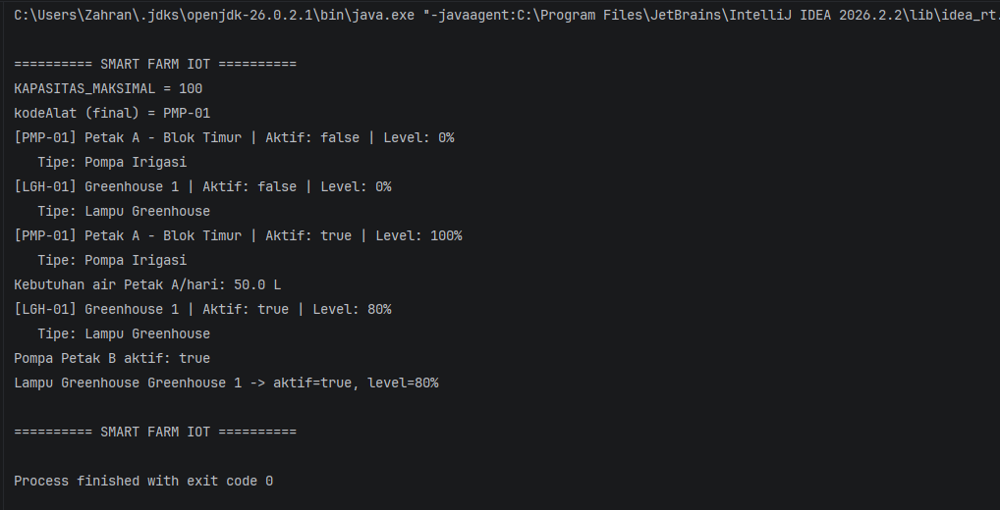

# Sistem Smart Farming IoT

## 1. Identitas
- **Nama**: _Zahran Febrian Nugraha_
- **NIM**: _H1D025074_
- **Tema**: IoT Sistem Smart Farming / Irigasi Otomatis

## 2. Deskripsi Sistem
Simulasi perangkat IoT pada lahan pertanian: **Pompa Irigasi** menyala otomatis
berdasarkan sensor kelembapan tanah, dan **Lampu Greenhouse** menyala otomatis
berdasarkan sensor intensitas cahaya. Keduanya berbagi struktur dasar lewat
superclass abstrak `PerangkatPertanian`.

## 3. Struktur Project
```
smart-farm-iot/
├── README.md
└── src/
    ├── PerangkatPertanian.java  # abstract superclass
    ├── Operasional.java         # interface
    ├── Pelapor.java             # interface
    ├── PompaIrigasi.java        # subclass
    ├── LampuGreenhouse.java     # subclass
    └── Main.java                # class pengujian (terpisah)
```

## 4. Pemetaan Persyaratan Teknis

| No | Requirement | Lokasi di Kode |
|---|---|---|
| 1 | State & Behavior | `PerangkatPertanian`: atribut + `info()` (void) + `hitungKebutuhanAirHarian()` (return value) |
| 2 | Immutability | `KAPASITAS_MAKSIMAL` (static final) & `kodeAlat` (private final) |
| 3 | Enkapsulasi & Overloading | Semua atribut `private` + getter/setter + 2 constructor di tiap class |
| 4 | Inheritance | `PompaIrigasi extends PerangkatPertanian`, `LampuGreenhouse extends PerangkatPertanian`; `Main` terpisah |
| 5 | Super Chaining | `super(...)` di constructor subclass; `super.info()` di `info()` override |
| 6 | Method Overriding | `@Override` pada `prosesSensor()`, `info()`, `nyalakan()`, `matikan()`, `isAktif()` |
| 7 | Abstract Class | `PerangkatPertanian` abstract + `abstract void prosesSensor(int)` |
| 8 | Logika State Percabangan | `if/else` di `prosesSensor()` pada `PompaIrigasi` & `LampuGreenhouse` |
| 9 | Polimorfisme Interface | `Operasional alatOperasional = pompaCustom;` di `Main.java` |
| 10 | Multiple Interface | `LampuGreenhouse implements Operasional, Pelapor` |

## 5. Cara Compile & Run (Terminal)
```bash
cd src
javac *.java
java Main
```

## 6. Screenshot Luaran Program
__